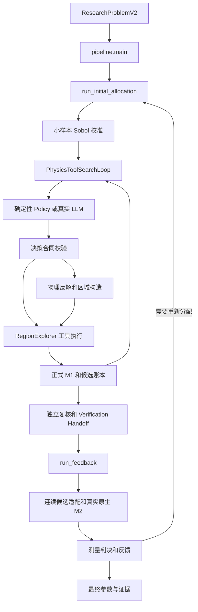

# 架构与调用链

Policy 提议动作，Runner 审查并执行，工具计算，验证器独立判决。Policy 不得修改硬规格、扩大用户域、越过预算或自行声明 PASS。

正式 CLI 默认是新版连续域多候选分配：`--problem` 指定当前 Spec，省略 allocator 时用 `agent/spec_allocation.json`；只有 `--out` 使用 nominal 示例。`_execution_route` 在任何输入读取/执行前互斥检查所有模式并拒绝未被消费的参数。冻结兼容链只由显式 `--legacy-frozen` 进入；Python 旧 `run_pipeline` 保留兼容用途。每次 CLI 启动及 `execution_route.json` 标明实际路由，详见 [COMPATIBILITY](COMPATIBILITY.md)。

`pll-spec-allocation-1.0` 配置由同一 `pipeline.main` 分派到 `agent/spec_allocation.py`。它给原 `run_initial_allocation` 添加 Cold Start 和候选池配置，再调用原 `run_feedback`；不增加第二套求解或验证实现。`PoolSearchLoop` 继承 `PhysicsToolSearchLoop`，只补池数量/质量停止、逆解近重复筛除和按需原 Sobol；`PoolDeterministicPolicy` 和受授权门禁约束的 `PoolLLMPolicy` 共用同一决策校验、构造、RegionExplorer 与正式 M1。M2 仍由原 controller 与 `verification.continuous` 执行和判决。

`candidate_pool.py` 在原问题的 log/linear 六轴归一化坐标中按距离去重，保留最佳 M1 裕量的代表点。M2 候选先满足配置质量门槛，首点按原 M1 rank，后续兼顾距已测点的距离。所有原始、失败、近重复证据仍保存在原账本，重复过滤不改变正式验证算法。`deterministic_feedback.py` 提取 V2 已有 BW 偏差修正与低调谐点探索规则，不将局部反馈解释为物理定理。

|模块|关键入口|产物与职责|
|---|---|---|
|`exploration/contracts.py`|resolve_problem / check_candidate / judge|问题、单位、域、必要条件、逐约束裕量|
|`agent/initial_allocation.py`|run_initial_allocation / PhysicsToolSearchLoop|校准、物理策略到工具的翻译|
|`agent/subregion_loop.py`|prepare_initial|有限 Sobol 校准和 PhysicsContext|
|`agent/physics_tool_policy.py`|build_state / adapt / make_policy|真实观察、物理先验、预算和合法工具动作|
|`agent/region_policy.py`、`llm_transport.py`|LLMRegionPolicy.decide|真实 API、严格 JSON、metadata 和错误|
|`agent/search_loop.py`|AgentSearchLoop.run / finish|观察→决策→执行→反馈；独立最终复核|
|`exploration/physics_region_builder.py`|build_physics_region / gain_tuning_interval|原域合法种子和未认证局部盒|
|`allocation/physics.py`|inverse_at_shape / pm_ceiling|当前拓扑条件反解及必要条件|
|`region_explorer/explorer.py`|RegionExplorer.execute / _sample|原 Sobol/SLSQP、缓存、边界和正式 M1 计费|
|`physics_mapping/model.py`|M1Evaluator.evaluate|连续 BW/UGF、名义 PM、调谐点|
|`agent/candidates.py`|CandidateArchive / rank|有效证据、M1 可行优先和 maximin 裕量排序|
|`agent/handoff.py`|build_handoff / validate_handoff|完整参数、当前问题和独立复核绑定|
|`agent/feedback.py`|run_feedback / feedback_summary|真实 M2、跨层预算、反馈与新候选复验|
|`verification/continuous.py`|verification_request / execute_request / judge_measurements|连续候选到原 TB 的适配、超时隔离、按来源判决|
|`verification/simulator.py`、`kernel.cpp`|simulate|PFD/CP/LF/VCO/Divider 真实行为闭环|

## 策略与工具

多点交付的 `m2_target_count` 与初始 M1 池 `target_count` 分离。原 `run_feedback` 累计质量及距离合格的联合通过点，首个通过不再必然停止；先换池内未测点，再预算内补点或修复。成功补点携带 `REPLENISH_JOINT_POOL` 和已通过点，不捏造失败。`spec_allocation` 再按原生来源筛选输出 `joint_candidates` / `sizing_handoff.json`，TEST、仅 M1、FAIL、UNKNOWN 点不得进入。旧配置默认目标1，原单点路径不变。

确定性 Policy 使用预先定义的物理构造和局部优化顺序；LLM 选择策略、BW 目标分数、调谐偏好、区域、活动变量和预算。共用原反解与正式评价器。

动作包括 BUILD_PHYSICS_REGION、OPTIMIZE_LOCAL、PROBE_REGION、MEASURE_LOCAL_SENSITIVITY、REVERIFY、STOP。非法提案只留档、不执行；Provider 失败不会冒充确定性成功。

反解依赖理想 CP、线性 VCO 和既定两电容一电阻滤波器：由形状和 BW 重建 Rz、Icp×Kvco，再求增益分解和调谐交集。包含标量数值求根，不是任意 PLL 的闭式逆。

`exploration/regions.py:sensitivity` 进行六轴局部有限差分，`agent/subregion_tools.py` 通过正式 M1 执行。输出局部矩阵、弹性、扰动点与证据 ID，再送 Planner State。它不是 M2 捕获梯度或全局单调性证明。

SLSQP 优化最差归一化 M1 裕量，动态捕获通过外层反馈参与。求解收敛、M1 可行和 M2 通过分别记录。

标准初始分配与联合验证不读取历史实验目录或报告。`studies/` 是可选对照编排，不能作为第二套正式 Pipeline。兼容路径和保留的旧版本键见 COMPATIBILITY。

新连续域 Agent 默认使用三模式配置，也可显式传旧单点 allocator。冻结兼容链使用 `allocation/AllocationStrategyPolicy`，其旧 `llm_agent` 反馈分支未实现；连续域的真实 LLM 反馈由 `agent/feedback.py` 接入 `run_initial_allocation`。候选池的实际决策来源、真实 API 次数与 M2 来源单独记录，不能仅从兼容标签判断。全部维护文件逐项职责见 [CODE_MAP](CODE_MAP.md)。
