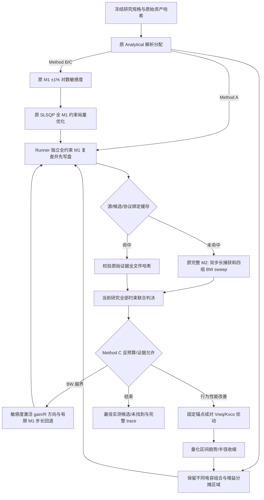

# Stage 6B 实现与实际算法

实现基线为 master `cd70cf4` 加 Stage5/6A 未提交成果的逐文件快照；独立分支为 `codex/stage6b-sensitivity-allocation`。安全证据在 `experiments/stage6b/safety_01`。未把 HEAD 当成完整研究基线，未合并主分支。

正式入口仍为 `python -m pll_allocation pipeline`。新增 `--multispec <problem.json> --method A|B|C --evaluation-cache <new-stage-cache>`。外层协调逻辑留在原 `pipeline.py`，每次新完整 M2 都调用其原 `run_pipeline`，采用只提交完整候选的固定 Policy。原有场景入口与策略照常使用。

## 复用与新增职责

|位置|实际职责|复用语义|
|---|---|---|
|`physics_mapping/`|原 M1 evaluate/Registry、BW/PM/UGF/tuning|公式、单位与原始有效域不变|
|`allocation/allocate.py`、`physics.py`|原 Analytical、敏感度、SLSQP、物理反解|原字节保留；没有第二套公式|
|`allocation/multispec_constraints.py`|新证据来源合同、研究判决、词典序目标|不执行 TB，不新增 PLL 方程|
|`allocation/multispec_search.py`|新确定性完整候选提议|只提议，不能宣布 M2 PASS|
|`verification/`|原完整 M2 与原始测量协议|源代码、三个内核与协议均保持|
|`pipeline.py`|新增研究路由、独立复查、预算/缓存/持久化|复用原完整运行函数；唯一正式入口|
|`tools/run_stage6b.py`|固定顺序调用正式 CLI 的实验驱动|不包含模拟器或判决实现|

准确原路径、SHA256、适用域和语义在交付闭环 `reuse_manifest.json`。适用域为固定理想行为模型和原声明六参数空间，不代表器件可实现性。

## 实际初始化与敏感度

Analytical 按原 C1/C2 离散枚举，在峰值相位形状 `sqrt(1+C2/C1)` 反解中点 BW；合法增益分摊、f0 投影和原排序保持。B/C 使用同一解析中心调用原敏感度：Icp、Rz、f0、Kvco 各 ±1%，边界处截取合法范围，共9次完整 M1。离散电容不求导，实际枚举。

原 SLSQP 在缩放的 `[Icp*Kvco/N, Rz, Kvco, Vreq]` 坐标上最大化最小约束裕量，包含 BW 双边、PM 下限、连续参数域和调谐约束；实际对数导数构成1%一阶启发式 guard。该 guard 不是行为误差认证。求解成功标志不代替 M1 全量判决。B/C 的首次候选完全相同，不使用 Stage6A 边界失败作为初始点。

额外池保留每个适用电容组合的完整 M1 可行候选，以及合法增益分摊区间25%/75%位置。它们未经 M2 时只称预测可行。池内所有正式 M1 计费；原 Analytical/SLSQP 的廉价代数试探单独计数。B 也建立相同池以保持与 C 首次候选和准备成本一致，但不进行反馈搜索。

## 反馈、变量激活与停止

C 首次同 B。当前最佳候选 BW 硬失败时，实际敏感度的 BW 弹性激活 gain 与 Rz；退化列被冻结。围绕原锚点分别尝试 ±0.08 对数步长，经完整 M1 拒绝时最多回退到0.04、0.02、0.01。每次拒绝均记录和计费。用已测 BW / 同点 M1 BW 的局部差异乘新 M1 预测，筛选最小 BW/PM 裕量较好的试探；这只是需要完整 M2 复验的局部启发式，没有校准或修改 M1。

其余情况下依冻结顺序成对 Vreq−/+（初始0.08V），再 Kvco−/+（初始0.08对数）。Vreq 改变 f0；Kvco 变化同时重建 Icp 保持乘积，并重建 f0 保持 Vreq。Icp/Kvco 的等效动态列和 f0 的动态零列来自实际敏感度。每对固定同一锚点与步长；每次都转换回原始完整 BlockSpec，域外不裁剪伪装有效。

捕获的双步长时间差和1µs块分辨率形成保守区间；重叠仅标为 `RESOLUTION_OVERLAP_NO_EXACT_GRADIENT`，非重叠才报告局部方向改善/退化。没有精确梯度假设。连续两次不改善，后续半径减半；低于0.01对数或0.01V停止。四个局部操作后切换尚未测量的 M1 可行区域，优先不同 C1/C2，再沿池内原顺序。当前原型只进行一次此局部轮次，预算内继续访问未测区域。

任何未知测量先停止诊断；无合法新候选、M1/cheap预算用尽、M2槽用尽均停止。局部搜索失败不是全域不可行证明。

## 联合证据与预算

BW 使用原 M2 收敛包络；PM 使用 M1 预测；调谐为严格 `0<Vreq<1.2V`；捕获使用原0.15V、160µs、0.4/0.2ns、1µs块、末端至少10连续有效块协议。捕获时间区间为 `fine ± abs(coarse-fine) ±1µs`，是原 Stage6A hull+resolution 的保守超集。穿过上限返回 UNKNOWN，可靠窗口未捕获返回 FAIL；非收敛/缺失/异常/非法数不通过。

统一 constraint row 保存边界、来源/协议/域、预测或实测值、包络、违例、裕量、状态。先按可行性、未知证据数、最大归一化违例排序；只有硬约束通过后才按 B1 捕获优先，或 B2 最小归一化裕量优先。不会让捕获改善抵消 PM/BW 失败。归一化为 BW 半区间、PM 下限、调谐0.6V、捕获40µs。

每方法/场景96 M1、10000 cheap、最多6候选槽；完整子流程的前置和事后 M1 均计入。缓存绑定候选、完整源码/原生库身份和原资产/协议，验证原始子运行全部文件 SHA。缓存命中不计新 M2，却消耗一个候选槽。A/B 按定义测一次就结束；这是上限相同，不强迫其执行额外搜索。

严格周期 PM 与1µHz频率精度仍 UNKNOWN；原完整 SystemSpec 的 FAIL/UNKNOWN 原样保留。`RESEARCH_JOINT_FEASIBLE` 仅为声明研究约束的混合证据判决，`FULL_SYSTEMSPEC_CERTIFIED` 始终 false。

## 验证与 trace

历史376项测试先通过；新增边界、组合判决、候选转换、BW反馈、成对量化趋势、区域切换、缓存篡改和预算测试后，完整404项通过。开发失败全部保留于 devtests_01/02；devtests_03通过。后续源码归档解包发现旧工具可选Git元数据问题，新增3项归档身份测试；修复不涉及模型/协议或Stage6B冻结算法。最终407项回归以finaltests/交付回执为准。

每方法 trace 为逐事件 SHA256 哈希链，包含成本、敏感度、候选提交、全量复查、M2起止、原始证据索引、反馈和停止。完整过程 trace 汇总安全隔离/构建/失败测试/冻结计划/正式运行/保护与交付回执。汇总索引明确标为后建 artifact index，原始实时事件保持原时间；不伪造此前每次编辑的实时记录。
