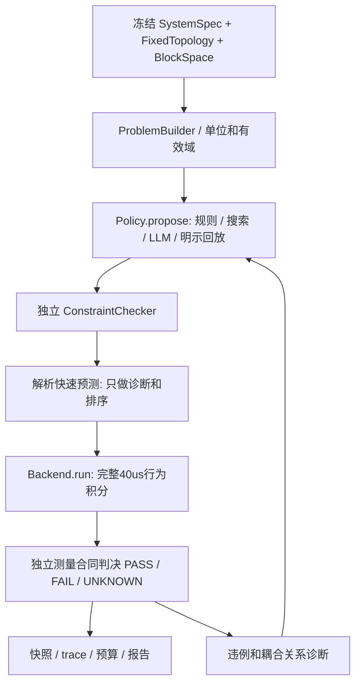

# P0 目标架构

唯一入口：`python -m pll_allocation run --problem <json> --policy <name> --out <new-dir>`；批量比较使用同一入口的 `suite` 子命令。运行不读取旧目录、不依赖安装旧包。

最小依赖：Python标准库；已提取行为内核。测试用pytest；可选LLM SDK/HTTP后端与外部模拟器均在适配边界。原生输入为JSON，不要求PyYAML。新包与旧 pll_spec_alloc/pll_agent 名字隔离，避免错误导入本机editable安装。

|职责|合同|必须落实的边界|
|---|---|---|
|问题|SystemSpec/FixedTopology/BlockSpaceModel|每指标单位、方向、目标、允差、测量条件及来源；输入哈希冻结|
|候选|JointBlockSpec|五Block完整；固定PFD/Divider及共同条件同样显式保存|
|策略|AllocationPolicy.propose(problem, history, remaining)|只产生候选/理由/停止，不提供最终验收权|
|约束|check(problem,candidate)|单位、有限数、范围、拓扑、N·fref、Veq、初值、模型域|
|快速计算|ScreeningPrediction|CP平衡相位、Veq；不能当作TB测量|
|模拟器|BehavioralBackend.capabilities / run|声明指标/测量协议/模型版本；接收冻结问题+完整候选+独立目录；输出测量和原始证据|
|评价|BehavioralEvaluation|状态、metrics、units、windows、domain、violations、margins、cost、artifact refs|
|轨迹|AllocationAttempt/AllocationResult|首次提议先落盘；每次真实调用含失败均计数；候选及输入哈希|

后续 Simulator/Verifier 可通过两个 Python Protocol 注入，外部CLI通过版本化JSON信封；未来MATLAB不必被Python重写。外部后端不能自己扩大支持域、改变输入和返回任意PASS；验收层依据冻结指标和协议独立计算。具体接口与生命周期见 `docs/INTERFACE_CONTRACT.md`。

行为后端以原有周期电荷/精确RC/线性VCO为唯一首版验收模型；与策略解析预测实现分离，但不是新的独立晶体管参照。频域采样验证、噪声、抖动等不受此内核支持；即使其他指标通过也必须返回UNKNOWN/UNSUPPORTED。
