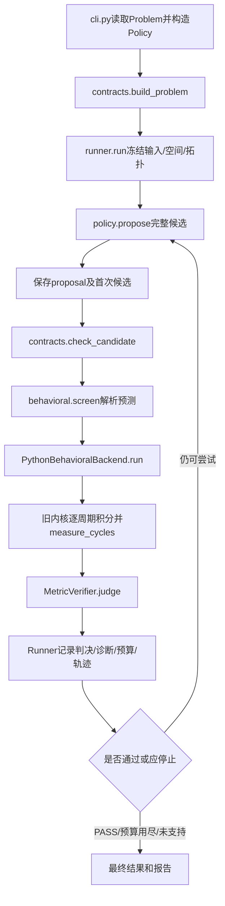

# PLLAgent 当前行为主线：模型、规格、模块空间和代码导读

核对日期：2026-11-04。本文只解释当前可访问源码和已经保存的结果，不修改模型、规格或研究方向。本次没有重新运行仿真；数值示例引用已有正式运行。

## 1. 当前运行的验证器是谁

当前分为三层：

|层|实现|负责什么|
|---|---|---|
|行为TB适配层|[PythonBehavioralBackend](F:/LJP/概伦AI/PLL_allocation/pll_allocation/behavioral.py:41)|接收新Problem/JointBlockSpec，转换旧内核输入，调用真实数值积分，保存周期轨迹与测量|
|行为积分与测量内核|[PythonBehavioralEvaluator](F:/LJP/概伦AI/PLL_allocation/pll_allocation/_legacy/evaluation/python_behavioral.py:34)、同文件measure_cycles|逐参考周期计算CP电荷、精确RC传播和VCO相位；从完整轨迹提取指标|
|最终指标验收层|[MetricVerifier](F:/LJP/概伦AI/PLL_allocation/pll_allocation/behavioral.py:97)|核对结果绑定、完整窗口、单位、模型域，按冻结SystemSpec重新比较；输出PASS/FAIL/UNKNOWN|

Backend ID为 `legacy_exact_rc_behavioral_tb_v1`；数学模型ID为 `signed_charge_exact_ideal_rc_linear_vco_v1`。

内核来自PLL_SPEC_ALLOC_BASELINE，提取时保持原字节，来源SHA在data/legacy/legacy_manifest.json。原内核也返回PREDICTED_PASS等旧字段，新主线保留在raw_model_report里；Runner使用MetricVerifier对实际metrics的重新判决作为最终接受条件。

当前不启动MATLAB或ngspice。历史纠正后MATLAB的24组9600周期轨迹已被复制到验证参考目录，测试比较实现一致性。它说明新Python实现对这些条件复现了旧数学模型，不授予独立晶体管模型准确性。

## 2. TB如何计算一次PLL运行

设参考周期为T，e为反馈相位减参考相位，单位cycle。每周期：

1. 将e包装到[-0.5,0.5)cycle，转换为时序误差 `d=-wrapped(e)*T`。复位时间限制允许脉宽范围，发生截断则声明域不通过。
2. CP按照局部电荷律计算 `q=q0+Iup*d`（d非负）或 `q=q0+Idown*d`（d负）。
3. 电荷瞬时注入滤波器：`ΔVctrl=q/(C1+Cload)`。
4. 两个电容电压用精确理想RC状态转移推进一个参考周期，并求该周期控制电压的精确积分。
5. 线性VCO增益把电压积分转换为反馈相位增量，更新e。保存相位、周期频率、Vctrl、时序、电荷及周跳索引。

代码位置：[周期计算循环](F:/LJP/概伦AI/PLL_allocation/pll_allocation/_legacy/evaluation/python_behavioral.py:55)。

这是覆盖完整40µs观察窗口的参考周期行为TB。CP脉冲以总电荷表示，PFD/Divider为理想行为，VCO为线性频率律。没有逐MOS开关波形、PFD触发器、VCO振幅或随机相位噪声。TB中的“真实执行”指实际计算动态轨迹，而不是从静态公式或固定字典返回PASS。

## 3. SystemSpec与测量合同

基准文件：[regular80.json](F:/LJP/概伦AI/PLL_allocation/examples/regular80.json)。一个Problem信封包含SystemSpec、固定拓扑、工况、初值、测量协议、Block Space；这些对象在逻辑上分开，运行时分别保存快照。

|项目|regular80/tight80/finite_domain80|joint84|
|---|---|---|
|参考频率|10MHz|10.5MHz|
|分频比|8|8|
|目标输出|80MHz|84MHz|
|电源、温度|1.8V、27℃|相同|
|Vctrl、Vc2初值|均1.1774V|相同|
|初始反馈相位误差|0cycle|相同|
|观察时间|40µs=400周期|40µs=420周期|
|尾窗口|最后50完整周期=5µs|最后50完整周期≈4.7619µs|
|锁定保持窗口|20周期=2µs|20周期≈1.9048µs|

初始相位误差为0不代表初始已锁定。原VCO在1.1774V时约80.283872MHz，仍会产生动态调整。

硬规格为：

|指标|当前通常目标|精确定义|
|---|---|---|
|mean_phase_abs_deg|≤0.2°|最后50周期的有符号反馈相位先求平均，再取绝对值，即abs(mean(phi))|
|tail_max_abs_frequency_error_ppm|≤100ppm|最后50周期中，周期输出频率相对目标频率误差的绝对值最大值|
|lock_status|==LOCKED|存在连续20周期同时满足abs(phi)<5°、abs(freq error)<100ppm；最后50周期全部满足这两条件，且尾段无周跳|

所有示例中上述数值指标的额外tolerance均为0。相位相对于反馈/参考10或10.5MHz，不能直接当作80/84MHz输出相位噪声或jitter。

abs(mean(phi))不是mean(abs(phi))，也不是max(abs(phi))；模型另报phase_absmax_deg，但当前常规SystemSpec不对其设硬门限。锁定使用5°宽门限，稳态性能另用0.2°严门限，因此LOCKED而SystemSpec FAIL是合法结果。

0.2°相位对应时差：10MHz时约55.56ps，10.5MHz时约52.91ps。100ppm对应80MHz的8kHz、84MHz的8.4kHz；这里是尾窗口最大周期误差限制。

|示例|变化和用途|
|---|---|
|frozen80.json|原80MHz规格，q0含0及正负值；110个声明候选|
|regular80.json|原0.2°规格，q0只取6/8/10fC；30点，避免仅靠理想q0=0通过|
|tight80.json|同30点域，相位改为0.19°|
|finite_domain80.json|同30点域，相位改为0.1°；穷尽未找到，不声明连续域无解|
|joint84.json|84MHz、CP/LF/VCO联合450点域，0.2°/100ppm/LOCKED保持|
|unsupported_jitter80.json|增加1ps、10kHz–10MHz积分jitter目标；后端缺噪声模型，返回UNSUPPORTED|

后端还输出lock_time_s、output_frequency_Hz、Vctrl极值和纹波；当前普通案例没有对锁定时间、带宽、相位裕度、功耗或抖动设置验收要求。lock_time_s沿用“首次20周期保持窗口开始”的诊断定义，不等同最后一次违例之后的严格settling time。

## 4. 每个Block的模型和允许空间

这里须区分：行为模型给出输入输出关系；Block Space声明允许选择哪些性能参数；电路能力数据给出某个已实现电路的观测。当前运行使用显式有限choices的声明目标域，标记DECLARED_TARGET。没有把旧模型卡全部自动加载为可实现器件能力，也没有独立训练五个新代理模型。

### PFD

理想相位/时序变换，d=-wrapped(e)*T。`reset_s=2ns`固定；用于允许时序边界，不展开UP/DOWN门级波形。没有死区、传播延迟、随机抖动或真实复位逻辑模型。对应数学处理在内核循环中，无独立pfd.py。

### CP

[cp.py](F:/LJP/概伦AI/PLL_allocation/pll_allocation/_legacy/physics/cp.py:11)保存电荷律和零电荷平衡点：

`q(d)=q0+I_direction*d`；`d_eq=-q0/I_direction`；`phi_eq=-360*fref*d_eq`。

|参数|80MHz非零域|84MHz域|
|---|---|---|
|Iup、Idown|80/90/100/110/120µA|相同|
|方向耦合|Iup=Idown，只是一个独立电流轴|相同|
|q0|6/8/10fC|2/4/6/8/10fC|

frozen80另保留q0=-10到10fC、步长2fC。q0已经包括局部代理负载的DC电荷需求，不能再次扣Rload漏电。模型没有新的I(Vctrl)或动态开关特性；旧实测局部时序域约±100ps，但新声明目标没有获得对应电路经验准确度保证。

### LF

网络为C1对地、Rz串C2对地；代理Cload并入C1。固定C1=100pF、C2=1nF、Cload=50fF，所以传播使用C1eff=100.05pF；Rz可选3820或5000Ω。

状态为Vctrl和Vc2，周期之间遵守：

`C1eff*dVctrl/dt=(Vc2-Vctrl)/Rz`；`C2*dVc2/dt=(Vctrl-Vc2)/Rz`。

CP电荷作为周期开始时的电压跳变；[lf.py::operators](F:/LJP/概伦AI/PLL_allocation/pll_allocation/_legacy/physics/lf.py:5)计算精确RC传播和积分。理想小信号阻抗为：

`Z(s)=(1+s*Rz*C2)/(s*(C1eff+C2)+s²*Rz*C1eff*C2)`。

Rload=1GΩ作为共同代理条件保存，DC需求已吸收到q0；传播没有再加入其增量电导。50fF/1GΩ是声明负载代理，不是已测真实VCO输入导纳。lf.py还保留impedance/requirements工具，当前主循环主要调用operators，不由阻抗函数自动完成BW/PM验收。

### VCO

频率律为 `f(V)=f0+Kvco_Hz_per_V*(V-V0)`；相位由频率积分得到。模型嵌入系统积分器，没有另建vco.py。V0不是0V；f0表示Vctrl=V0时的锚点频率。

|参数|80MHz|84MHz联合域|
|---|---|---|
|V0|1.17V|固定相同|
|f0|79.165465366MHz|79.165465366 / 81.165465366 / 83.165465366MHz|
|Kvco|151.136039933MHz/V|120.908831947 / 151.136039933 / 181.363247920MHz/V|
|Vctrl有效域|[1.13,1.21]V|固定相同|

80MHz锚点源自历史L0_cal，84MHz的offset/factor是新的性能目标，不能称为9个已实现VCO。单位严格为Hz/V，使用角频率公式时才乘2π。没有相位噪声、振幅、压摆率或频率非线性模型。

候选先检查Veq=V0+(fout_target-f0)/Kvco是否在域内；TB后还检查整段Vctrl轨迹，不只检查平衡点。

### Divider

理想固定÷8，其作用在相位反馈的1/N里实现。候选N必须等于operating_context.N，且fout_target=N*fref。没有门级时序、最高工作频率能力或分频附加噪声模型；无独立divider.py。

联合空间规模：regular80为5电流×3电荷×2电阻=30点；joint84为5×5×2×3频率×3增益=450点。PFD/Divider和其余单元素choices固定。当前候选必须精确属于声明choices，不支持策略临时提出连续域内的任意新值。

## 5. 代码结构和设计职责

|文件|主要函数或类|设计职责|
|---|---|---|
|[__main__.py](F:/LJP/概伦AI/PLL_allocation/pll_allocation/__main__.py)|main入口转发|使python -m pll_allocation运行CLI|
|[cli.py](F:/LJP/概伦AI/PLL_allocation/pll_allocation/cli.py:26)|read、make_policy、main|解析run/suite、读Problem、选择策略并调用Runner；无物理验收决策|
|[contracts.py](F:/LJP/概伦AI/PLL_allocation/pll_allocation/contracts.py:43)|build_problem|验证拓扑/工况/测量协议/规格和声明空间，复制输入；当前版本限定N=8、10–10.5MHz、1.8V/27℃|
|同上|check_candidate|验证五Block完整性、单位、choices、共同条件、CP耦合、PFD复位、VCO平衡/初值域；与Policy分开|
|同上|candidate_from_values、values_of、candidate_grid|完整规格DTO构造、取值、有限候选组合；canonical/digest提供可复现SHA|
|同上|AllocationPolicy/BehavioralBackend/BehavioralVerifier Protocol|给未来Agent、模拟器和验收器定义替换边界|
|[policies.py](F:/LJP/概伦AI/PLL_allocation/pll_allocation/policies.py:14)|多个Policy类|提出完整候选/理由或停止；没有授予PASS的权限|
|[behavioral.py](F:/LJP/概伦AI/PLL_allocation/pll_allocation/behavioral.py:21)|legacy_inputs|把五Block新合同转换为旧积分器的CP/LF参数和VCO模型；原核心不改字节|
|同上|screen|仅解析平衡相位与Veq；不运行动态TB，不授予PASS；当前也未作为剔除候选的动态筛选器|
|同上|PythonBehavioralBackend|真实调用旧核心，保存周期轨迹，补充输出频率、Vctrl极值和统一评价信封|
|同上|MetricVerifier|按冻结SystemSpec独立比较实际测量；旧内核自带PASS字段不是唯一验收条件|
|同上|CommandBehavioralBackend|外部argv命令/JSON桥；request.json输入，response.json输出，保存stdout/stderr和超时|
|[runner.py](F:/LJP/概伦AI/PLL_allocation/pll_allocation/runner.py:26)|run|固定执行顺序、首次保存、约束、完整TB、预算、停止、SHA轨迹、结果与报告；默认后端在此注入|
|同上|diagnosis|提取违例/已满足项/模型问题/解析物理关系；目前没有自动有限差分数值敏感度|
|[llm_transport.py](F:/LJP/概伦AI/PLL_allocation/pll_allocation/llm_transport.py:12)|main|独立子进程读取环境凭证并发HTTP；上层用总进程期限限制调用时长|
|[_legacy/evaluation/python_behavioral.py](F:/LJP/概伦AI/PLL_allocation/pll_allocation/_legacy/evaluation/python_behavioral.py:11)|measure_cycles、PythonBehavioralEvaluator|原字节积分和测量核心|
|_legacy/physics/cp.py、lf.py|电荷律、RC算子|原物理公式|
|_legacy/schemas.py、units.py|limits及旧校验依赖|保留核心依赖；旧validate_request固定80MHz，新入口不调用它，只用limits读目标|

数据对象目前用带schema_version的JSON/dict实现，没有机械创建SystemSpec等七个类。报告输出目前合并在Runner，诊断也较轻量，代码没有多Agent并发运行框架。

### 策略层内部

|策略|当前算法|是否利用真实反馈|
|---|---|---|
|RulePolicy|在有限联合网格上用解析相位违例、电流、abs(q0)、调谐距离、Rz等排序|排除已尝试候选；主要依赖解析先验|
|GridPolicy|按固定轴顺序取下一个完整候选|排除已试点；不据违例调整方向|
|RandomPolicy|固定seed洗牌有限网格|排除已试点|
|FeedbackSearchPolicy|初点先测；后续根据当前违例，优先降低解析相位违例，再偏好少改参数/接近当前点|有，但仍是简化的确定性解析反馈搜索|
|LLMPolicy|把冻结Problem、物理关系、历史实际违例和预算发送外部模型，让模型选完整候选|接口支持；真实成功响应与修复验收尚未完成|
|ReplayPolicy|读取已经保存的完整候选|明确回放，不算新LLM决策；TB仍重新实际计算|

llm_initial和llm_feedback使用同一LLMPolicy；CLI对initial限制一次提议/一次TB，对feedback允许剩余预算内重复提议。当前没有强连续优化器、代理优化器或通用数值敏感度决策模块。

## 6. 一次实际运行如何穿过代码

非法候选不进入TB，仍消耗提议次数；异常TB也消耗一次行为评价，返回UNKNOWN；当前不支持的硬指标使整体不能PASS。JSONL保存每次完整提议与前序SHA，源码/输入也有指纹。成功后的停止标准是找到行为可行点，没有宣称已找到全域最优。

真实已有80MHz反馈案例，记录在outputs/final_behavioral_suite/regular80__feedback：

|项目|第一次|第二次|
|---|---|---|
|CP电流|80µA|110µA|
|q0|6fC|6fC|
|Rz|3820Ω|3820Ω|
|解析平衡相位|0.270000°|0.196363636°|
|完整TB测量|0.270089669°|0.196436600°|
|相位≤0.2°|FAIL|PASS|

推导第一次：d_eq=-6fC/80µA=-75ps，phi_eq=-360×10MHz×(-75ps)=0.27°。因此旧规则/LLM可以获得清楚的物理提示，但实际验收仍取完整动态TB测量。第二次也同时重新检查频差、锁定和模型域。

## 7. 目录与测试如何配合

examples是运行输入；configs目前保存不含密钥的LLM环境配置；data/legacy保存冻结来源和锚点；data/verification_reference只供验证，不给Policy答案；outputs保存新运行；docs保存审计与阶段状态；learn保存阅读导引。

data/legacy/models.json不是每次运行自动读取的动态模型注册库。examples在生成时由该锚点形成，正式运行使用其内嵌且冻结的数值。旧大型model_cards.json也没有被运行时自动检索。

|测试文件|核验内容|
|---|---|
|tests/test_contracts.py|输入/候选完整性、单位、域、耦合及30/110/450点空间|
|tests/test_behavioral.py|24组历史数值锚点、提取SHA、不支持/超域/不绑定结果不能PASS|
|tests/test_matlab_trajectories.py|24组400周期完整历史MATLAB轨迹；参考快照SHA|
|tests/test_runner.py|首次文件在TB前保存、真实FAIL后复验、预算、异常、复现、防覆盖、命令桥及LLM总超时|

tools/audit_sources.py盘点旧工程和来源SHA；create_examples.py生成示例；inherit_matlab_reference.py继承只供验证的历史参考；validate_delivery.py核验正式输出/预算/轨迹并汇总对照。当前保存的最终回归为93通过；这份导读没有再次执行测试。

## 8. 当前系统的实质边界

当前是给定固定数学模型与离散性能目标域的联合分配底座，三项核心验收集中在稳态相位、频差与锁定。频域BW/PM、噪声/抖动、功耗与PVT没有进入可信验收；加入相应SystemSpec必须先补充真实测量后端。

Block Space含明确变量范围，但还不是由电路表征自动构建的完整多指标可实现域。显式跨Block关系主要是fout=N*fref和VCO调谐域；CP/LF/VCO动态耦合由行为方程体现，并没有再建一个通用关系图求解器。

现有简单规则在三组可行冒烟案例上均首次通过，说明当前基准较容易被解析关系解决。后续评价LLM价值需要更丰富且有真实TB支持的约束和任务分布，以及公平重复实验。真实LLM服务当前未产生候选，不能据这些运行给出LLM效率结论。
