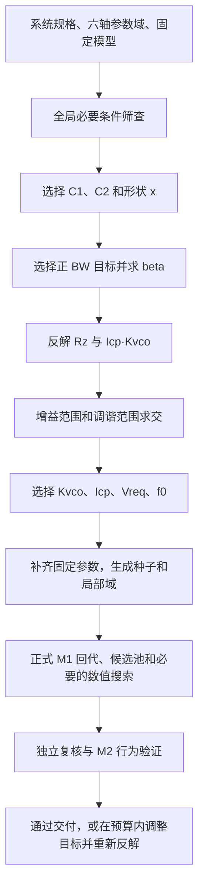

本文依据当前工作区源码整理，覆盖当前连续域主线的物理反解、候选构造及验证闭环。示例为本次重新计算的教学算例，不代表历史实验记录。

你的方法可以概括为：**系统规格和模块参数域 → 环路形状 → BW/UGF 换算 → 电阻与增益乘积 → 增益和调谐联合分配 → 完整候选 → M1 回代 → M2 验证与反馈。** 核心是带约束的条件反解；其中 BW/UGF 换算使用标量数值求根。



**1. 总输入：系统要求、参数域与固定上下文**

主线输入采用 `ResearchProblemV2`。每个自由参数包含 `min/max/default/unit/scale`；每个规格声明是否启用、上下限、容差和评价来源。构造请求还指定策略、BW 目标分数、调谐偏好、种子数量、区域宽度、预算及证据身份。

|输入类别|内容|本仓库 nominal 示例|
|---|---|---|
|系统规格|BW、PM、条件捕获时间，以及明确来源的其他指标|BW 150–300 kHz；PM ≥ 50°；捕获时间 ≤ 40 μs|
|CP 参数域|`Icp`，单位 A|20–400 μA|
|LF 参数域|`Rz` [Ω]、`C1` [F]、`C2` [F]|500–15000 Ω；20–300 pF；0.2–4 nF|
|VCO 参数域|`f0` [Hz]、`Kvco` [Hz/V]|40–79 MHz；5–80 MHz/V|
|固定频率计划|`f_ref`、`N`|10 MHz、8，因此目标输出为 80 MHz|
|固定控制电压轨|`Vctrl_min`、`Vctrl_max`|0–1.2 V，合法静态调谐点要求严格位于轨内|
|模型适用条件|理想对称 CP、线性 VCO、既定两电容一电阻 LF|曲率、失配、漏电、额外负载等相关非理想项为零|

`f0` 是 VCO 在控制电压为零时的频率截距。系统频率满足：

\[
F=Nf_{ref},\qquad f_{VCO}(V)=f_0+K_{vco}V,\qquad V_{req}=\frac{F-f_0}{K_{vco}}.
\]

本例的 jitter 虽配置了上限，但来源为 `UNSUPPORTED`；它不会因此成为标准反解已经解决的约束。

输入配置：`configs/problems/nominal.json`。合同和适用域：`pll_allocation/exploration/contracts.py`。

**2. 正向物理模型：反解从哪里来**

滤波器中，`C1` 直接接控制节点，另一支路由 `Rz` 与 `C2` 串联接地。其跨阻为：

\[
Z(s)=\frac{1+sR_zC_2}{s(C_1+C_2)+s^2R_zC_1C_2}.
\]

鉴相与电荷泵增益为 \(K_{pfd}=I_{cp}/(2\pi)\) [A/rad]；角频率形式的 VCO 增益为 \(2\pi K_{vco}\)。定义 \(K=I_{cp}K_{vco}/N\)，则：

\[
L(s)=\frac{KZ(s)}s,\qquad T(s)=\frac{L(s)}{1+L(s)},\qquad \frac{\phi_{out}}{\phi_{ref}}=NT(s).
\]

这里两个 \(2\pi\) 已相消。后续 BW 是归一化闭环响应 \(T\) 的 −3 dB 带宽；UGF 是开环 \(L\) 的单位增益交越频率，二者定义不同。

**输入：**完整模块参数。**输出：**开环/闭环传递函数与静态调谐关系。

源码：`pll_allocation/physics_mapping/model.py:166`，`pll_allocation/allocation/physics.py:8`。

**3. 用电容比和无量纲形状控制相位裕度**

令：

\[
C_\Sigma=C_1+C_2,\qquad q=1+\frac{C_2}{C_1},\qquad
\omega_z=\frac1{R_zC_2},\qquad \omega_p=q\omega_z,
\qquad x=\omega_uR_zC_2=\frac{\omega_u}{\omega_z}.
\]

正向模型可重写为：

\[
L(s)=\frac{K}{C_\Sigma}\frac{1+sR_zC_2}{s^2(1+sR_zC_2/q)}.
\]

在单位增益交越点：

\[
PM(x,q)=\arctan x-\arctan(x/q).
\]

上式角度以弧度表示，报告时乘 \(180/\pi\) 转为度。对固定电容比，最大相位裕度及对应形状是：

\[
x_{peak}=\sqrt q,\qquad
PM_{max}=\arcsin\frac{q-1}{q+1}
=\arcsin\frac{C_2}{2C_1+C_2}.
\]

因此先检查电容比是否允许达到要求，再决定绝对频率尺度。由上式还可推得，对于 \(0<\phi<90^\circ\)：

\[
PM_{max}\ge\phi\quad\Longrightarrow\quad
\frac{C_2}{C_1}\ge\frac{2\sin\phi}{1-\sin\phi}.
\]

例如 PM 至少 50° 时，电容比至少约为 6.54863。该比值公式是从源码相位上界推导的等价关系。

项目还实现了满足 PM 下限的形状区间。令 \(t=\tan\phi\)，则：

\[
t x^2-(q-1)x+qt\le0,\qquad D=(q-1)^2-4qt^2,
\]

\[
x_- =\frac{2qt}{q-1+\sqrt D},\qquad x_+=\frac q{x_-},\qquad x\in[x_-,x_+].
\]

只有 \(\phi\le PM_{max}\) 才有解；非正 PM 下限无需此正区间限制。

当前连续构造器并非每次都用上述区间选点：它先做上界筛查，再以 \(\sqrt q\) 为中心试探峰值及两侧形状，例如乘以 0.8、1.25；多样性策略还会连续改变形状。实际选定形状是否满足 PM，仍交给正式 M1 检查。

**输入：**电容域/电容对、PM 下限。**输出：**\(q\)、PM 上界、可用形状及筛除原因。

连续主线在电容域中采样；首个尝试使用 \(C_{1,min},C_{2,max}\)。历史冻结路径的九种电容组合并不是当前连续主线的搜索限制。

源码：`allocation/physics.py:23`、`:28`；`exploration/physics_region_builder.py:199`。

**4. 全局必要条件筛查**

构造器首先检查整个问题是否存在明确矛盾，主要包括：

- PM 要求超过 \(C_{1,min},C_{2,max}\) 所能给出的全局相位上界。
- 固定频率计划 \(Nf_{ref}\) 与已支持的输出频率要求冲突。
- 理想模型中为正的 BW/UGF/PM 被要求不大于非正值。
- 整个 `f0/Kvco` 域和控制电压轨形成的频率外包络都无法覆盖目标。

有这些证书时，可在反解前声明相应 M1 问题不可行。否则只表示必要条件尚未发现矛盾。单次构造失败、搜索预算耗尽或没有找到种子，都不能替代全局不可行证书。

**输入：**完整当前问题。**输出：**必要条件报告、证书或继续求解。

源码：`exploration/contracts.py:177`。

**5. 从闭环带宽目标数值求出 UGF**

选择 \(B^*>0\) 作为闭环带宽目标。对于双侧 BW 规格，构造器使用：

\[
B^*=B_{min}+\alpha(B_{max}-B_{min}),\qquad 0\le\alpha\le1.
\]

`target_bw_fraction` 可以给一个分数区间，构造器在其中选取 \(\alpha\)。单侧规格另有显式启发式目标区间，原硬约束仍由正式判决执行。

定义：

\[
h=\sqrt{\frac{1+(x/q)^2}{1+x^2}},\qquad
\beta=\frac{\omega_{BW}}{\omega_u}=\frac{BW}{UGF},\qquad y=\beta^2.
\]

将闭环条件 \(|T(j\omega_{BW})|^2=1/2\) 代入正向模型，可得：

\[
\left(\frac xq\right)^2y^3
+\left(1-\frac{2hx^2}{q}\right)y^2
-(2h+h^2x^2)y-h^2=0.
\]

取唯一正根 \(y\)，再得到：

\[
\beta=\sqrt y,\qquad \omega_u=\frac{2\pi B^*}{\beta},\qquad UGF=\frac{B^*}{\beta}.
\]

代码用对数坐标二分搜索求根，初始 \(\log y\) 区间为 \([-14,14]\)，迭代 80 次。根无法括住时记录数值失败。因此这一步在当前实现中属于数值求解。

推导核对式：令 \(r=\omega/\omega_u\)，有

\[
|T(jr\omega_u)|^2=
\frac{h^2(1+x^2r^2)}{(h-r^2)^2+x^2r^2(h-r^2/q)^2}.
\]

令 \(r^2=y\) 并令上式等于 \(1/2\)，即得到代码中的三次多项式。

**输入：**\(q,x,B^*\)。**输出：**\(\beta,\omega_u,UGF\)。

源码：`allocation/physics.py:57`、`:70`。

**6. 反解电阻和环路增益乘积**

形状定义直接给出：

\[
R_z=\frac{x}{\omega_u C_2}.
\]

由单位增益条件 \(|L(j\omega_u)|=1\) 得：

\[
K=C_\Sigma\omega_u^2h,\qquad
P\equiv I_{cp}K_{vco}=NK
=N(C_1+C_2)\omega_u^2\sqrt{\frac{1+(x/q)^2}{1+x^2}}.
\]

这里首先确定的是乘积 \(P\)。只靠这些理想小信号环路指标，不能唯一确定 `Icp` 与 `Kvco` 各自的取值。

当前构造器检查 \(R_z\) 是否在用户范围内；超界则丢弃此次构造，不把电阻裁剪回范围，因为裁剪会改变已经指定的形状和带宽。

**输入：**\(C_1,C_2,q,x,\omega_u,N\)。**输出：**所需 \(R_z,K,P\)，或电阻超界原因。

源码：`allocation/physics.py:100`；`exploration/physics_region_builder.py:228`。

**7. 将增益乘积分配给 Icp 与 Kvco，同时求调谐交集**

写 \(k=K_{vco}>0\)。由 \(I_{cp}=P/k\)，合法增益分配区间为：

\[
\mathcal K_{gain}=\left[
\max\left(k_{min},\frac P{I_{max}}\right),
\min\left(k_{max},\frac P{I_{min}}\right)
\right].
\]

区间为空，说明该次反解所需乘积无法由允许的 CP/VCO 增益组合实现。

此外，必须存在合法 \(f_0\)，使

\[
f_{0,min}\le f_0\le f_{0,max},\qquad
V_{min}<\frac{F-f_0}{k}<V_{max}.
\]

把存在性条件改写为：

\[
kV_{min}<F-f_{0,min},\qquad kV_{max}>F-f_{0,max}.
\]

把这两个严格不等式与 \(\mathcal K_{gain}\) 求交，得到联合合法区间 \(\mathcal K_{joint}\)。代码根据电压轨系数的正负决定上下界方向，也处理零系数；严格边界用 `math.nextafter` 向合法侧移动。

当前构造器在联合区间中按对数坐标分配增益：

\[
k=\exp\{\log k_{lo}+\lambda(\log k_{hi}-\log k_{lo})\},\qquad I_{cp}=P/k.
\]

普通策略常取 \(\lambda=0.5\)，即几何中点；增益或调谐探索可取 0.2、0.5、0.8；可选增强模式还可试区间端点。

原始 `inverse_at_shape` 自身只先检查增益区间并取算术中点，随后把居中调谐所需的 `f0` 限制在 `f0` 范围内。**当前构造器会在其外层重新求增益/调谐联合交集，再更新这些值。** 因此不能把原始函数中的中间分配当成最终主线策略。

**输入：**乘积 \(P\)、`Icp/Kvco/f0` 范围、电压轨、目标频率。**输出：**联合区间和若干合法 `Icp/Kvco` 分配，或增益/调谐冲突。

源码：`exploration/physics_region_builder.py:104`、`:237`。

**8. 选择静态调谐电压并反解 f0**

对已经选定的 \(k\)，允许的调谐电压集合为：

\[
\mathcal V(k)=(V_{min},V_{max})\cap
\left[\frac{F-f_{0,max}}k,\frac{F-f_{0,min}}k\right].
\]

构造器先计算上下端 \(v_{lo},v_{hi}\)，再根据偏好选择内部点：

\[
V_{req}=v_{lo}+\eta(v_{hi}-v_{lo}),\qquad f_0=F-kV_{req}.
\]

`LOW_VOLTAGE/INTERIOR/HIGH_VOLTAGE` 通常分别取 \(\eta=0.2/0.5/0.8\)；`DIVERSE` 则多点构造。最后再检查严格的轨内调谐裕量：

\[
m_V=\min(V_{req}-V_{min},V_{max}-V_{req})>0.
\]

**输入：**`Kvco`、`f0` 范围、目标频率、电压轨、调谐偏好。**输出：**`Vreq/f0` 以及调谐裕量。

源码：`exploration/physics_region_builder.py:248`；`exploration/contracts.py:151`。

**9. 输出完整种子和局部搜索域**

核心六参数是：

\[
\theta=(I_{cp},R_z,C_1,C_2,f_0,K_{vco}).
\]

`inverse_at_shape(model,c1,c2,target_bw,x,meter)` 返回这六个裸数值组成的字典；增益无合法交集时返回 `None`，求根等数值问题可能抛出异常。

外层 `build_physics_region(...)` 输出的则是构造提案，其中每个种子包含：

- 补齐固定上下文的完整参数；当前 nominal 共 17 项，数值均带单位。
- 参数哈希、种子 ID、来源、所用电容/形状/BW 目标和构造轨迹。
- 增益/调谐交集、必要条件筛查结果、局部区域与去重距离。
- 成功/部分成功/失败状态、实际尝试次数、反解调用次数与失败原因。
- `m1_evaluated=false` 和 `whole_region_M1_certified=false`。

局部域在种子生成后构造。单轴归一化为：

\[
u(p)=\frac{p-p_{min}}{p_{max}-p_{min}}\quad\text{或}\quad
u(p)=\frac{\log p-\log p_{min}}{\log p_{max}-\log p_{min}},
\]

分别对应线性轴和对数轴。区域为 \([\max(0,u-r),\min(1,u+r)]\)，当前 `LOCAL/BALANCED/BROAD` 半径分别为 0.08/0.15/0.25。这个区域用于搜索，尚未证明区域内每一点均满足规格。

**输入：**六参数、固定上下文和区域策略。**输出：**可追踪的完整种子与局部搜索盒。

源码：`exploration/contracts.py:122`、`:137`；`exploration/physics_region_builder.py:142`、`:284`、`:378`。

**10. 正式 M1 回代和数值搜索**

正式 M1 对完整候选重新计算传递函数、扫描频率并定位交越点：

\[
|L(j2\pi UGF)|=1,\quad |T(j2\pi BW)|=1/\sqrt2,\quad
PM=180^\circ+\arg L(j2\pi UGF).
\]

它还检查静态调谐点和连续模型稳定性。闭环特征多项式是：

\[
(R_zC_1C_2)s^3+(C_1+C_2)s^2+(KR_zC_2)s+K.
\]

对于正参数，Routh 条件中的关键差值为：

\[
bc-ad=KR_zC_2^2>0.
\]

这说明当前理想连续模型的相应稳定条件成立，不能直接代替行为捕获验证。

每个支持的规格边界分别形成裕量：

\[
m_{lower}=\frac{v-v_{min}+\epsilon}{S},\qquad
m_{upper}=\frac{v_{max}-v+\epsilon}{S},
\]

其中 \(\epsilon\) 为该规格容差，\(S\) 为归一化尺度。若需局部改进，现有 SLSQP 优化最差裕量：

\[
\max_{\theta\in\mathcal D}\min_jm_j(\theta).
\]

还可使用 Sobol 探索补充候选。正式候选池按质量和六轴距离保留不同点，推荐点再次独立调用正式 M1 复核。这里的“独立复核”表示独立执行回代，不代表使用了独立物理模型。

**输入：**完整候选和原规格。**输出：**M1 指标、逐约束裕量、可行性、候选池和交接证据。

源码：`physics_mapping/model.py:215`；`exploration/contracts.py:213`；`region_explorer/explorer.py:290`。

**11. M2 行为验证及反馈重新反解**

M2 对推荐候选运行原生 PFD/CP/LF/VCO/Divider 行为闭环，在既定协议下测量 BW 和条件捕获时间。标准捕获协议使用初始控制电压 0.15 V、观测窗口 160 μs。当前标准 M2 未认证的周期 PM、完整 jitter/power 等仍保持各自的 `UNKNOWN` 状态。

若 M2 BW 失败，而有对应 M1/M2 带宽数据，当前确定性反馈可用局部偏差修正：

\[
B^*_{new}=\frac{B_{min}+B_{max}}2\frac{B_{M1}}{B_{M2}},\qquad
\alpha_{new}=\operatorname{clip}\left(\frac{B^*_{new}-B_{min}}{B_{max}-B_{min}},0.1,0.9\right).
\]

然后重新调用原物理构造器。该修正是局部经验假设。若条件捕获失败，策略会探索较低的调谐电压，并在合适情况下选较高 BW 目标；新候选仍须重新验证。控制器也可先选择池内尚未测试的其他候选。

在固定电容和形状下，还存在源码给出的频率缩放关系：

\[
R'_z=R_z/a,\qquad P'=a^2P,\qquad
UGF'=a\,UGF,\quad BW'=a\,BW,\quad PM'=PM.
\]

它说明如何改变频率尺度，但缩放后仍需满足增益、电阻、调谐范围并重新验证。上述反馈代码实际采用的是更新 BW 目标后重新反解。

**输入：**M1/M2 绑定同一候选的真实结果、失败指标和剩余预算。**输出：**后续候选选择、重分配请求、重验或如实停止。

源码：`agent/deterministic_feedback.py:40`；主线调用边界见 `docs/ARCHITECTURE.md`。

**12. 可选物理增强怎样接到原反解上**

这些增强由开关启用，继续复用上述反解和正式评价流程。

- 启动感知：在安全调谐区间试探 \(V_{req}\approx0.15+\Delta V\)，并限制在安全上下界内，再由 \(f_0=F-kV_{req}\) 构造参数，同时保留中间调谐点等候选。这里只改变种子构造偏好。
- 条件噪声分配：在显式噪声谱、独立噪声源和积分频带下，用
  \(\sigma_t=\sqrt{\int_{f_l}^{f_h}\sum_i|H_i(f)|^2S_i(f)\,df}/(2\pi F)\)
  估算 jitter，并在原候选族内筛选形状、电容和增益分配；可选优化也会加入条件噪声裕量。
- 解析动态描述和物理排序：为候选附加模型适用域内的描述与预测，供选点使用，不新增正式验证结论。

这些都保留条件性。不能把条件噪声估计解释为标准 M2 已验证的完整 jitter，也不能把启动偏移种子解释为已经证明的锁定时间解。

源码：`exploration/physics_region_builder.py:255`、`:294`；`physics_mapping/noise.py:31`；`configs/agent/physics_enhanced.json`。

**13. 一组完整的数值算例**

采用当前 nominal 参数域，手动选取域内的一对电容，以便清楚演示整条链：

\[
C_1=50\,pF,\quad C_2=2\,nF,\quad B^*=225\,kHz,\quad
F=80\,MHz,\quad N=8,\quad PM_{min}=50^\circ.
\]

这不是当前构造器首个电容对，也不是历史最优参数；算例采用与当前构造器相同的联合区间、对数中点和内部调谐选择规则。

|阶段|结果|
|---|---|
|电容比与峰值形状|\(q=41\)，\(x=\sqrt{41}=6.40312424\)|
|PM 上界|72.24720984°|
|满足 PM≥50° 的形状区间|[1.26956933, 32.29441592]|
|BW/UGF 数值换算|\(\beta=1.34596329\)，\(\omega_u=1.05033822\times10^6\) rad/s|
|电阻与增益|\(R_z=3048.12492\,\Omega\)，\(K=353.19965836\)，\(P=2825.59726686\) A·Hz/V|
|联合 Kvco 区间|[7.06399317, 80] MHz/V|
|几何中点分配|\(K_{vco}=23.77224124\) MHz/V；\(I_{cp}=118.86120618\) μA|
|允许的调谐集合|\([0.04206587,1.2)\) V|
|内部调谐点|\(V_{req}=0.62103293\) V|
|反解的频率截距|\(f_0=65.23665526\) MHz|

最终六参数为：

```text
Icp  = 118.86120618 μA
Rz   = 3048.12492067 Ω
C1   = 50 pF
C2   = 2 nF
f0   = 65.23665526 MHz
Kvco = 23.77224124 MHz/V
```

正式 M1 回代得到：输出频率 80 MHz，UGF 167.16652043 kHz，BW 225.00000000 kHz，PM 72.24720984°，调谐电压 0.62103293 V；已支持的 M1 规格判为 `FEASIBLE`。所有启用规格的综合状态仍为 `UNKNOWN`，因为本次未运行 M2，且 nominal 中还有未支持的 jitter 要求。

本次还直接代入无量纲闭环模平方公式，在目标 BW 处得到 0.5000000000000001，并运行与相位区间、反解、缩放、乘积分配和调谐交集相关的现有回归：**15 passed，76 deselected**。这些验证支持推导及同模型回代一致性，未提供 M2 或器件级验证证据。

**接口速查**

|步骤/接口|输入|输出|
|---|---|---|
|`screen_problem(problem)`|完整规格和参数域|必要条件与全局矛盾证书|
|`pm_ceiling(c1,c2)` / `phase_interval(c1,c2,pm)`|电容对、PM 要求|相位上界、形状区间或无解|
|`bandwidth_ratio(q,x)`|无量纲环路形状|数值求根得到的 BW/UGF 比值|
|`inverse_at_shape(model,c1,c2,target_bw,x,meter)`|形状、目标带宽、固定参数与范围|六参数原始候选，或 `None`/数值异常|
|`gain_tuning_interval(problem,P)`|所需增益乘积与当前问题|合法 Kvco 联合区间或冲突|
|`build_physics_region(...)`|问题、策略请求、预算及来源身份|完整种子、局部域、构造轨迹和实际成本|
|正式 M1 + `judge(...)`|完整候选及原规格|正向指标、裕量、M1 可行性及未解决项|
|M2 + 反馈控制器|绑定候选的交接信息、协议与预算|实测结果、联合状态、后续选点/重新反解动作|
